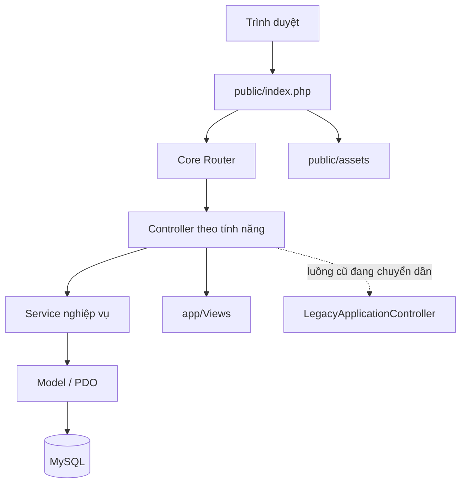

# Kiến trúc StreakFit

## Quy ước

- Chỉ `public/` được Apache phục vụ; `.htaccess` tại thư mục dự án đẩy URL vào front controller và ánh xạ tài nguyên tĩnh sang `public/assets`.
- `Core\Router` nhận URL sạch, `Request` chuẩn hóa đường dẫn theo `APP_URL`, `Response` phát HTML/JSON hoặc redirect.
- `Core\Database` tạo PDO dùng chung; model dùng prepared statements và khớp với schema SQL hiện tại.
- Controller nhận request và điều phối luồng; Service giữ điều kiện nghiệp vụ và transaction; view chỉ hiển thị dữ liệu đã chuẩn bị.
- Session có cookie HttpOnly/SameSite; biểu mẫu dùng CSRF token. Middleware tương ứng nằm trong `app/Middlewares`.

## Quy tắc nghiệp vụ đã tách

- `CheckInService`: khóa dòng hội viên, ngăn nhiều buổi đang mở hoặc nhiều buổi hợp lệ/ngày, lưu ảnh JPEG, chốt buổi khi đủ 1.800 giây.
- `ScoreCalculationService`: tính `C`, `M`, `E`, điểm buổi và điểm streak theo mục tiêu tuần; phần tính điểm được gọi bởi luồng chốt tuần hiện tại.
- `CourtAppealService`: kiểm tra lượt kháng cáo và xử lý biểu quyết; phiếu không cho phép tự bỏ phiếu.
- `PenaltyPoolService`: quản lý đăng ký quỹ, đề xuất và biểu quyết mức phạt tháng.

Schema thực tế hiện dùng tên `weekly_scores`, `appeals` và `fund_transactions`; các lớp `WeeklyRecord`, `LeaveRequest` và `PenaltyLog` ánh xạ những tên này, không giả định bảng mới.

## Chuyển đổi luồng hiện hữu

`LegacyApplicationController` là adapter tạm thời cho các thao tác biểu mẫu cũ. Router đã đưa các màn hình qua URL sạch; check-in, biểu quyết kháng cáo, tính điểm và một số thao tác quỹ đã gọi service. Có thể tiếp tục chuyển các nhánh POST và truy vấn màn hình sang controller/model riêng mà không đổi schema hay URL.